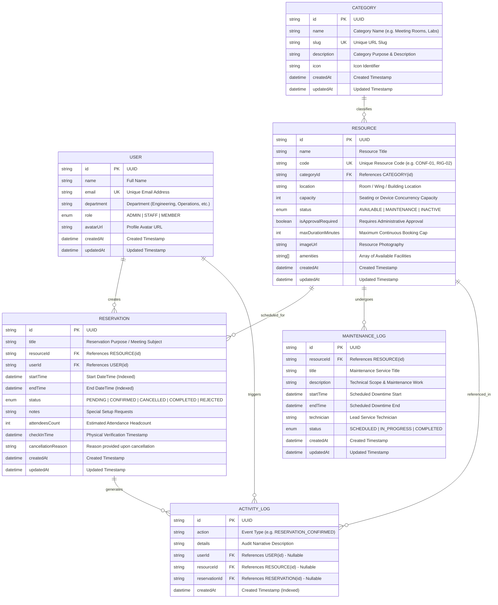

# PrimeWave Resource Reservation Management System
## Entity Relationship (ER) Diagram & Database Architecture Specification

This document provides the formal Entity Relationship (ER) specification for the PrimeWave Resource Reservation Management System, developed for the **PrimeWave Lab Software Engineering Internship Technical Assessment**.

---

## 1. Visual Entity Relationship (ER) Diagram (Mermaid)



---

## 2. Entity Dictionary & Relational Constraints

### 2.1 User Entity
Represents members, staff, and administrators within the organization.
- **`id`** (`UUID`, Primary Key): Globally unique user identifier.
- **`email`** (`VARCHAR`, Unique): System sign-in and contact address.
- **`name`** (`VARCHAR`): Full name.
- **`department`** (`VARCHAR`): Department name (Hardware, Software, Operations, IT, Design).
- **`role`** (`ENUM: ADMIN, STAFF, MEMBER`): Role-based permission level.
- **`avatarUrl`** (`VARCHAR`, Optional): Profile picture.

### 2.2 Category Entity
Organizes assets into logical groups (e.g., Conference Rooms, Testing Rigs, Media Studios).
- **`id`** (`UUID`, Primary Key): Unique identifier.
- **`name`** (`VARCHAR`): Human-readable name.
- **`slug`** (`VARCHAR`, Unique): URL-safe identifier for fast routing.
- **`description`** (`TEXT`, Optional): Description of resources in this category.
- **`icon`** (`VARCHAR`, Optional): Lucide icon reference.

### 2.3 Resource Entity
Represents the physical facility, equipment, or testing rig being managed.
- **`id`** (`UUID`, Primary Key): Unique resource identifier.
- **`code`** (`VARCHAR`, Unique): Standardized organizational asset code (e.g., `CONF-01`).
- **`name`** (`VARCHAR`): Name of the resource.
- **`categoryId`** (`UUID`, Foreign Key -> `Category.id`): Mandatory category relation (`ON DELETE CASCADE`).
- **`location`** (`VARCHAR`): Geographic or physical position (e.g., *Level 3 - West Wing*).
- **`capacity`** (`INTEGER`): Headcount or device occupancy limit.
- **`status`** (`ENUM: AVAILABLE, MAINTENANCE, INACTIVE`): Master administrative operational state.
- **`isApprovalRequired`** (`BOOLEAN`): Requires admin sign-off if `true`.
- **`maxDurationMinutes`** (`INTEGER`): Maximum single reservation booking limit.
- **`amenities`** (`TEXT[]`): PostgreSQL native text array storing facilities (4K Display, Soldering, Acoustic isolation).

### 2.4 Reservation Entity
Represents an active, pending, or historical resource booking.
- **`id`** (`UUID`, Primary Key): Unique booking identifier.
- **`resourceId`** (`UUID`, Foreign Key -> `Resource.id`): The booked facility.
- **`userId`** (`UUID`, Foreign Key -> `User.id`): The booking creator.
- **`startTime`** (`TIMESTAMP WITH TIME ZONE`): Beginning of reservation.
- **`endTime`** (`TIMESTAMP WITH TIME ZONE`): Conclusion of reservation.
- **`status`** (`ENUM: PENDING, CONFIRMED, CANCELLED, COMPLETED, REJECTED`): State machine status.
- **`attendeesCount`** (`INTEGER`): Expected headcount.
- **`notes`** (`TEXT`, Optional): Booking purpose or equipment setup notes.
- **`checkInTime`** (`TIMESTAMP WITH TIME ZONE`, Optional): Recorded when user marks presence.
- **`cancellationReason`** (`TEXT`, Optional): Stored upon cancellation.

### 2.5 MaintenanceLog Entity
Represents scheduled or active technical downtime for a resource.
- **`id`** (`UUID`, Primary Key): Maintenance record identifier.
- **`resourceId`** (`UUID`, Foreign Key -> `Resource.id`): Resource under service.
- **`title`** (`VARCHAR`): Maintenance title (e.g., *Optical Calibration*).
- **`description`** (`TEXT`): Work orders and technical notes.
- **`startTime`** / **`endTime`** (`TIMESTAMP WITH TIME ZONE`): Window of unavailability.
- **`technician`** (`VARCHAR`, Optional): Designated technician name.
- **`status`** (`ENUM: SCHEDULED, IN_PROGRESS, COMPLETED`): State of maintenance work.

### 2.6 ActivityLog Entity
Comprehensive immutable audit log capturing key operational events.
- **`id`** (`UUID`, Primary Key): Log record identifier.
- **`action`** (`VARCHAR`): Action classification code (e.g. `RESERVATION_CONFIRMED`, `RESERVATION_CANCELLED`, `RESERVATION_CHECKED_IN`).
- **`details`** (`TEXT`): Human-readable explanatory log narrative.
- **`userId`** (`UUID`, Foreign Key -> `User.id`, Optional, `ON DELETE SET NULL`).
- **`resourceId`** (`UUID`, Foreign Key -> `Resource.id`, Optional, `ON DELETE SET NULL`).
- **`reservationId`** (`UUID`, Foreign Key -> `Reservation.id`, Optional, `ON DELETE SET NULL`).
- **`createdAt`** (`TIMESTAMP WITH TIME ZONE`): Audit timestamp.

---

## 3. Concurrency & Conflict Prevention Architecture

### 3.1 Strict Overlapping Interval Detection
To prevent double-booking, the reservation engine executes atomic queries ensuring no time interval intersection exists. Two intervals `[start_A, end_A]` and `[start_B, end_B]` overlap if and only if:
$$\text{start}_A < \text{end}_B \quad \land \quad \text{end}_A > \text{start}_B$$

In Prisma/PostgreSQL, this is verified atomically within an isolated transaction:
```typescript
const conflict = await tx.reservation.findFirst({
  where: {
    resourceId,
    status: { in: ["CONFIRMED", "PENDING"] },
    startTime: { lt: requestedEnd },
    endTime: { gt: requestedStart },
  },
});
```

### 3.2 Performance Indexing Strategy
To ensure sub-millisecond query evaluation even as reservation volume grows into tens of thousands of records, the following composite indexes are applied:
1. `@@index([resourceId, startTime, endTime])` on `Reservation`: Accelerates availability checks and conflict scanning.
2. `@@index([userId, startTime])` on `Reservation`: Accelerates user-specific upcoming reservation views.
3. `@@index([resourceId, startTime, endTime])` on `MaintenanceLog`: Accelerates blackout period checking.
4. `@@index([categoryId, status])` on `Resource`: Optimizes filtered inventory catalog searches.
5. `@@index([createdAt])` on `ActivityLog`: Provides high-throughput audit feed streaming.
